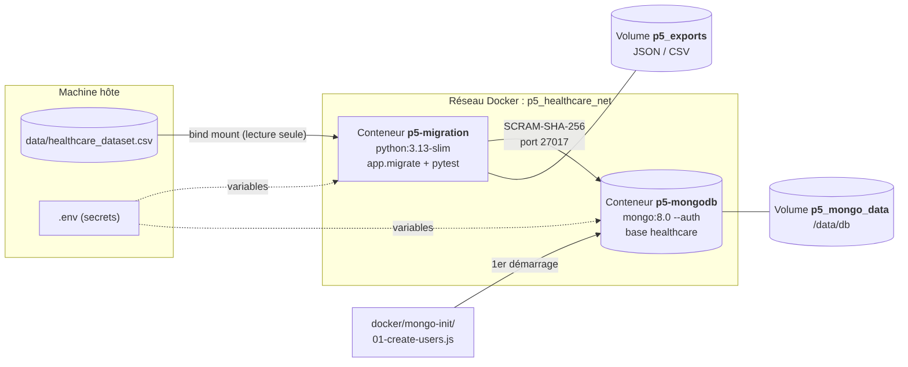
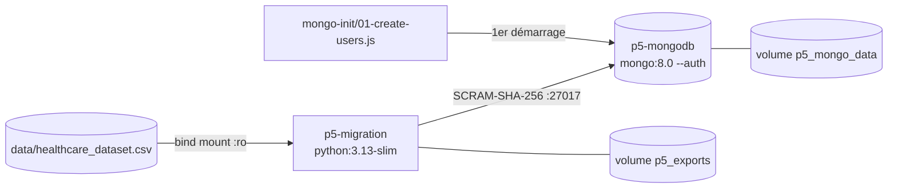
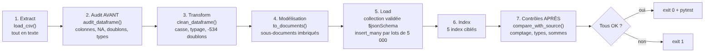
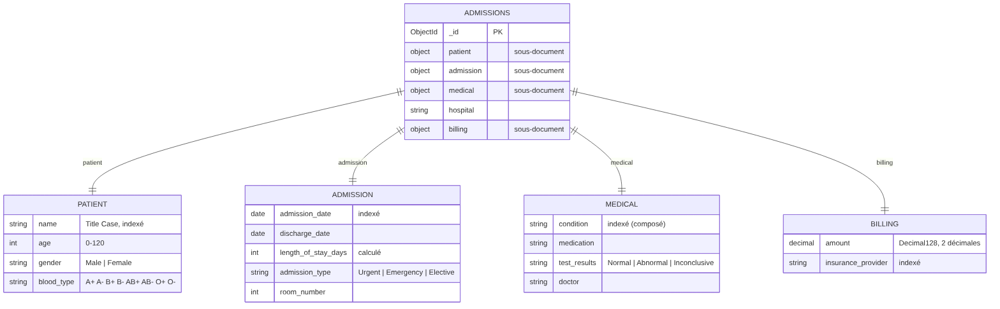
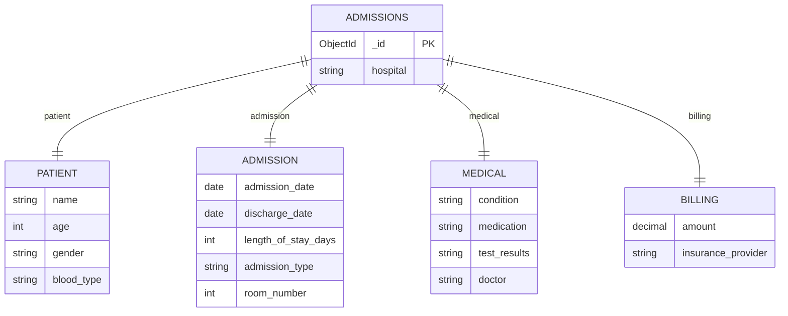
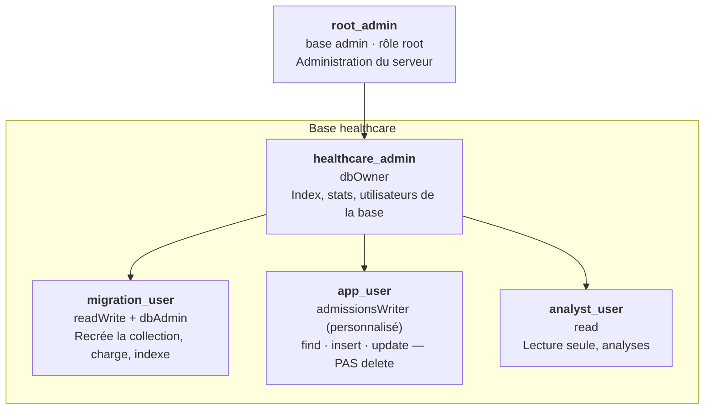

# Migration de données médicales vers MongoDB avec Docker

> **DataSoluTech** — Mission de migration du dataset médical d'un client vers une solution NoSQL scalable horizontalement.
> Auteur : Nedjma Mbaye, Data Engineer (stagiaire) · Encadrant : Boris, chef de projet

Ce dépôt contient un programme **automatisé, conteneurisé et testé** qui transfère un fichier CSV de 55 500 séjours hospitaliers vers une base **MongoDB 8.0** sécurisée par authentification et rôles, ainsi que la documentation des options de déploiement sur **AWS**.

---

## Sommaire
1. [Contexte](#1-contexte)
2. [Architecture](#2-architecture)
3. [Arborescence du dépôt](#3-arborescence-du-dépôt)
4. [Démarrage rapide (Docker)](#4-démarrage-rapide-docker)
5. [Fonctionnement de la migration](#5-fonctionnement-de-la-migration)
6. [Schéma de la base de données](#6-schéma-de-la-base-de-données)
7. [Authentification et rôles utilisateurs](#7-authentification-et-rôles-utilisateurs)
8. [Tests d'intégrité automatisés](#8-tests-dintégrité-automatisés)
9. [Opérations CRUD et export](#9-opérations-crud-et-export)
10. [Exécution sans Docker (développement)](#10-exécution-sans-docker-développement)
11. [Docker : notions clés](#11-docker--notions-clés)
12. [Déploiement sur AWS](#12-déploiement-sur-aws)
13. [Dépannage](#13-dépannage)
14. [Organisation Git](#14-organisation-git)

---

## 1. Contexte

Le client, un acteur de santé, rencontre des problèmes de **scalabilité** dans ses traitements quotidiens. DataSoluTech lui propose de migrer ses données vers **MongoDB**, une base NoSQL orientée documents qui se met à l'échelle **horizontalement** (réplication et *sharding* sur plusieurs serveurs) au lieu d'imposer un serveur toujours plus gros.

**Objectifs de la mission**
- automatiser la migration du CSV vers MongoDB par un script Python ;
- conteneuriser MongoDB **et** le script avec Docker pour un déploiement portable ;
- sécuriser l'accès (authentification, rôles au moindre privilège) ;
- garantir l'intégrité des données par des tests automatisés avant et après migration ;
- étudier le déploiement sur AWS ([docs/aws-cloud.md](docs/aws-cloud.md)).

**Les données** : `data/healthcare_dataset.csv` — 55 500 lignes, 15 colonnes (patient, pathologie, dates d'admission et de sortie, médecin, hôpital, assureur, montant facturé, chambre, type d'admission, traitement, résultats d'examen).

### Concepts MongoDB utilisés

| Concept | Définition | Dans ce projet |
|---|---|---|
| **Document** | Enregistrement au format BSON (JSON binaire typé), structure souple et imbriquable | Un séjour hospitalier |
| **Collection** | Ensemble de documents (équivalent souple d'une table) | `admissions` |
| **Base de données** | Conteneur de collections, avec ses propres utilisateurs | `healthcare` |

## 2. Architecture





| Élément | Nom | Rôle |
|---|---|---|
| Service | `mongodb` (conteneur `p5-mongodb`) | Base MongoDB 8.0 officielle, authentification activée |
| Service | `migration` (conteneur `p5-migration`) | Exécute la migration puis la suite de tests, puis s'arrête |
| Volume nommé | `p5_mongo_data` | Persistance des données MongoDB (`/data/db`) |
| Volume nommé | `p5_exports` | Fichiers exportés (JSON/CSV) |
| Bind mount | `./data → /data/csv` (lecture seule) | Fournit le CSV au script sans le copier dans l'image |
| Bind mount | `./docker/mongo-init → /docker-entrypoint-initdb.d` | Script de création des rôles et utilisateurs |
| Réseau nommé | `p5_healthcare_net` (bridge) | Réseau privé : le script joint la base par le nom DNS `mongodb` |

Le port 27017 n'est publié que sur `127.0.0.1` : la base n'est pas exposée au réseau local.

## 3. Arborescence du dépôt

```
.
├── app/                          # Code Python de la migration
│   ├── config.py                 # Configuration (variables d'environnement, URI)
│   ├── transform.py              # Extraction, audit, nettoyage/typage, conversion en documents
│   ├── database.py               # Connexion, validateur $jsonSchema, index, insertion par lots
│   ├── integrity.py              # Contrôles d'intégrité post-migration
│   ├── migrate.py                # Point d'entrée : orchestre toute la migration
│   ├── crud_demo.py              # Démonstration Create / Read / Update / Delete
│   └── export_data.py            # Export complet en JSON et CSV
├── tests/
│   ├── conftest.py               # Fixtures pytest
│   ├── test_transform.py         # Tests unitaires (sans base) : intégrité du CSV et transformation
│   └── test_migration.py         # Tests d'intégration : données migrées, index, validateur, rôles
├── data/healthcare_dataset.csv   # Dataset source fourni par le client
├── explore.py                    # Exploration et audit initial du dataset (étape 2)
├── docker/mongo-init/01-create-users.js   # Rôles et utilisateurs MongoDB
├── docs/
│   ├── aws-cloud.md              # Recherches AWS (étape 3)
│   ├── journal.md                # Journal de bord du projet
│   ├── diagrams/*.mmd            # Sources Mermaid des schémas
│   └── img/*.png                 # Schémas rendus
├── Dockerfile                    # Image du service de migration
├── docker-compose.yml            # Orchestration des 2 services, volumes et réseau
├── requirements.txt              # Dépendances Python versionnées
├── .env.example                  # Modèle de configuration (à copier en .env)
└── README.md
```

## 4. Démarrage rapide (Docker)

### Prérequis
- [Docker Desktop](https://www.docker.com/products/docker-desktop/) (Windows/macOS) ou Docker Engine + plugin Compose v2 (Linux) ;
- Git ;
- ~1 Go d'espace disque pour les images.

Vérifier l'installation :
```bash
docker --version
docker compose version
```

### Déploiement pas à pas

```bash
# 1. Récupérer le projet
git clone https://github.com/Nedjmamb59/p5-migration-mongodb.git
cd p5-migration-mongodb

# 2. Créer le fichier de configuration et CHANGER les mots de passe
cp .env.example .env
#    (Windows PowerShell : Copy-Item .env.example .env)

# 3. Construire l'image de migration et démarrer MongoDB + la migration
docker compose up --build

# Résultat attendu dans les logs du conteneur p5-migration :
#   Migration RÉUSSIE : 55500 lignes lues, 534 doublons écartés, 54966 documents insérés
#   ==================== 20 passed ====================
#   p5-migration exited with code 0

# 4. (autre terminal) Vérifier l'état des conteneurs
docker compose ps
```

Le service `migration` s'arrête de lui-même une fois terminé (code de sortie 0 = succès). MongoDB continue de tourner.

### Commandes utiles

| Action | Commande |
|---|---|
| Lancer en arrière-plan | `docker compose up -d --build` |
| Suivre les logs de la migration | `docker compose logs -f migration` |
| Relancer la migration seule (idempotente) | `docker compose run --rm migration` |
| Démonstration CRUD | `docker compose run --rm migration python -m app.crud_demo` |
| Exporter toute la base | `docker compose run --rm migration python -m app.export_data` |
| Lancer uniquement les tests | `docker compose run --rm migration python -m pytest -v` |
| Ouvrir un shell MongoDB (analyste) | `docker compose exec mongodb mongosh -u analyst_user -p --authenticationDatabase healthcare healthcare` |
| Arrêter (données conservées) | `docker compose down` |
| Tout supprimer, volumes compris | `docker compose down -v` |

### Vérifier les données à la main
```bash
docker compose exec mongodb mongosh -u analyst_user -p --authenticationDatabase healthcare healthcare
```
```javascript
db.admissions.countDocuments()                       // 54966
db.admissions.findOne({}, {_id: 0})
db.admissions.aggregate([{ $group: { _id: "$medical.condition", n: { $sum: 1 } } }])
db.admissions.insertOne({ test: 1 })                 // refusé : l'analyste est en lecture seule
```

## 5. Fonctionnement de la migration



La commande `python -m app.migrate` enchaîne les étapes suivantes (chacune est une fonction distincte et commentée) :

| # | Étape | Fonction | Ce qui est fait | Pourquoi |
|---|---|---|---|---|
| 1 | Extraction | `transform.load_csv` | Lecture du CSV avec **toutes les colonnes en texte** | Maîtriser le typage nous-mêmes, sans conversion implicite |
| 2 | Audit avant migration | `transform.audit_dataframe` | Contrôle des 15 colonnes attendues, valeurs manquantes, doublons, champs numériques et dates convertibles, valeurs catégorielles hors liste, montants négatifs | Détecter un fichier corrompu **avant** d'écrire en base ; arrêt immédiat si une colonne manque |
| 3 | Nettoyage et typage | `transform.clean_dataframe` | Espaces superflus, casse des noms (`bOBby JacksOn` → `Bobby Jackson`), virgules parasites dans les noms d'hôpitaux, conversion en `int` / `float` / `datetime`, suppression des **doublons stricts** | Données cohérentes et requêtables (recherche par nom, filtres par date) |
| 4 | Modélisation | `transform.to_documents` | Chaque ligne devient un document à sous-documents (`patient`, `admission`, `medical`, `billing`), montant en `Decimal128`, durée de séjour calculée | Voir [schéma](#6-schéma-de-la-base-de-données) |
| 5 | Chargement | `database.prepare_collection` + `insert_documents` | Recréation de la collection avec un **validateur `$jsonSchema`**, insertion par lots de 5 000 (`insert_many`) | Idempotence (relançable sans doublons), typage garanti côté serveur, performances |
| 6 | Indexation | `database.create_indexes` | Création de 5 index (après insertion, plus rapide) | Accélérer les requêtes métier prévues |
| 7 | Contrôle après migration | `integrity.compare_with_source` | Nombre de documents, absence de champs nuls, mêmes catégories, **somme des montants identique au centime**, types BSON | Prouver que rien n'a été perdu ni altéré |

Le script renvoie le code **0** si tous les contrôles passent, **1** sinon (exploitable par Docker, un ordonnanceur ou une CI).

### Constats sur les données et décisions

| Constat (audit) | Volume | Décision |
|---|---|---|
| Valeurs manquantes | 0 | — |
| Doublons stricts (lignes identiques sur les 15 colonnes, montant au centime près) | **534** | **Supprimés** : un même patient ne peut avoir deux séjours identiques au centime près, ce sont des erreurs d'ingestion. Résultat : **54 966 documents** |
| Casse aléatoire des noms (`LesLie TErRy`) | toutes les lignes | Normalisés en *Title Case* |
| Noms d'hôpitaux terminés par une virgule (`Hernandez Rogers and Vang,`) | 4 776 | Virgule finale retirée |
| Montants facturés négatifs | 108 | **Conservés** (probables avoirs/remboursements) et signalés dans l'audit : décision métier à valider avec le client |
| Date de sortie antérieure à l'admission | 0 | Contrôle maintenu dans les tests |

### Typage des champs

| Champ CSV | Type CSV | Type MongoDB (BSON) | Justification |
|---|---|---|---|
| Age, Room Number | texte | `int` | Comparaisons et agrégats numériques |
| Date of Admission, Discharge Date | texte `AAAA-MM-JJ` | `date` | Requêtes par période, calcul de durées, index temporels |
| Billing Amount | texte (15 décimales) | `decimal` (Decimal128, 2 décimales) | Montant monétaire : pas d'erreur d'arrondi des flottants |
| Champs catégoriels | texte | `string` contraint par `enum` | Le validateur refuse une valeur inconnue (`Malee`, `C+`…) |

## 6. Schéma de la base de données

- Base : `healthcare` · Collection : `admissions` · **1 document = 1 séjour hospitalier**





### Exemple de document
```json
{
  "_id": { "$oid": "6b00c92767f06c32838464ea" },
  "patient":   { "name": "Bobby Jackson", "age": 30, "gender": "Male", "blood_type": "B-" },
  "admission": { "admission_date": { "$date": "2024-01-31T00:00:00Z" },
                 "discharge_date": { "$date": "2024-02-02T00:00:00Z" },
                 "length_of_stay_days": 2, "admission_type": "Urgent", "room_number": 328 },
  "medical":   { "condition": "Cancer", "medication": "Paracetamol",
                 "test_results": "Normal", "doctor": "Matthew Smith" },
  "hospital":  "Sons and Miller",
  "billing":   { "amount": { "$numberDecimal": "18856.28" }, "insurance_provider": "Blue Cross" }
}
```

### Correspondance CSV → document

| Colonne CSV | Champ MongoDB |
|---|---|
| Name / Age / Gender / Blood Type | `patient.name` / `patient.age` / `patient.gender` / `patient.blood_type` |
| Date of Admission / Discharge Date | `admission.admission_date` / `admission.discharge_date` |
| — (calculé) | `admission.length_of_stay_days` |
| Admission Type / Room Number | `admission.admission_type` / `admission.room_number` |
| Medical Condition / Medication / Test Results / Doctor | `medical.condition` / `medical.medication` / `medical.test_results` / `medical.doctor` |
| Hospital | `hospital` |
| Billing Amount / Insurance Provider | `billing.amount` / `billing.insurance_provider` |

### Choix de modélisation
- **Une seule collection, documents imbriqués** : le CSV ne contient **aucun identifiant patient** : après normalisation, 40 235 noms distincts pour 54 966 séjours, sans moyen de distinguer un patient revenu à l'hôpital d'un homonyme. Créer une collection `patients` séparée supposerait de deviner qui est qui à partir du nom : risque de fusionner deux personnes différentes. Chaque séjour reste donc autonome, et un séjour se lit en **une seule requête, sans jointure**.
- **Sous-documents** : regroupent les champs par thème, rendent le document lisible et facilitent les projections (`{patient: 1}`) et des droits futurs plus fins.
- **Prêt pour le sharding** : des documents autonomes se répartissent facilement entre serveurs ; une clé candidate serait `{ "admission.admission_date": 1, "_id": "hashed" }` ou un identifiant patient si le client en fournit un.

### Validation côté serveur
La collection est créée avec un validateur `$jsonSchema` (`validationLevel: strict`, `validationAction: error`) : champs obligatoires, types BSON, bornes (âge 0–120) et listes de valeurs autorisées. Un document non conforme est **rejeté par MongoDB**, quel que soit le client qui l'envoie.

### Index

| Index | Champs | Requête servie |
|---|---|---|
| `idx_patient_name` | `patient.name` | Retrouver les séjours d'un patient |
| `idx_condition_admission_date` | `medical.condition` ↑, `admission.admission_date` ↓ | Séjours d'une pathologie sur une période, du plus récent au plus ancien |
| `idx_admission_date` | `admission.admission_date` | Activité par jour/mois/année |
| `idx_hospital` | `hospital` | Analyses par établissement |
| `idx_insurance_provider` | `billing.insurance_provider` | Facturation par assureur |
| `_id_` (automatique) | `_id` | Accès direct à un document |

Un test vérifie, via `explain()`, que l'index composé est bien utilisé par une requête « pathologie + période ». Les index ne sont pas multipliés : chacun ralentit les écritures et consomme de la mémoire.

## 7. Authentification et rôles utilisateurs

### Mécanisme d'authentification
- L'authentification est **activée** : l'image officielle `mongo` démarre en mode `--auth` dès que `MONGO_INITDB_ROOT_USERNAME` est défini. Toute connexion anonyme est refusée.
- Mécanisme **SCRAM-SHA-256** (*Salted Challenge Response Authentication Mechanism*), imposé dans le script de création des utilisateurs et dans l'URI de connexion.
- Les utilisateurs applicatifs sont créés dans la base **`healthcare`** (leur base d'authentification) ; seul le super-administrateur est dans `admin`.
- Les mots de passe sont lus dans **`.env`** (jamais dans le code, `.env` est exclu de Git) et transmis aux conteneurs par variables d'environnement. Le script Python les encode (`quote_plus`) pour supporter les caractères spéciaux.

### Hachage des mots de passe
MongoDB **ne stocke jamais les mots de passe en clair** :
1. à la création, un **sel** aléatoire est généré pour l'utilisateur ;
2. le mot de passe est dérivé avec **PBKDF2-HMAC-SHA-256** et ce sel, en **15 000 itérations** par défaut (coût volontairement élevé contre la force brute) ;
3. seuls le sel, le nombre d'itérations, et deux clés dérivées (`StoredKey`, `ServerKey`) sont stockés dans `admin.system.users` ;
4. à la connexion, client et serveur échangent un **défi-réponse** : le mot de passe ne circule pas sur le réseau et le client vérifie aussi l'identité du serveur (authentification mutuelle).

Le sel rend inutilisables les tables précalculées (*rainbow tables*) et donne deux empreintes différentes à deux utilisateurs ayant le même mot de passe.

### Rôles (principe du moindre privilège)



| Utilisateur (`.env`) | Rôle(s) MongoDB | Peut | Ne peut pas | Usage |
|---|---|---|---|---|
| `root_admin` (base `admin`) | `root` | Tout, sur toutes les bases | — | Administration du serveur uniquement, jamais par une application |
| `healthcare_admin` | `dbOwner` sur `healthcare` | Gérer index, collections et utilisateurs de `healthcare` | Toucher aux autres bases | DBA du client |
| `migration_user` | `readWrite` + `dbAdmin` sur `healthcare` | Recréer la collection, son validateur et ses index, insérer | Gérer les utilisateurs | Script de migration |
| `app_user` | `admissionsWriter` (**rôle personnalisé**) | `find`, `insert`, `update` sur `admissions` | **Supprimer** des documents ou la collection | Application métier du client |
| `analyst_user` | `read` sur `healthcare` | Lire, agréger | Toute écriture | Data analysts, BI |

Le rôle personnalisé `admissionsWriter` est défini dans [`docker/mongo-init/01-create-users.js`](docker/mongo-init/01-create-users.js) : sur des données médicales, la suppression doit rester une opération exceptionnelle et tracée, réservée à l'administrateur.

Ces droits sont **vérifiés par des tests automatisés** : l'analyste ne peut pas écrire, l'application ne peut ni supprimer un document ni supprimer la collection.

> ⚠️ Le script d'initialisation ne s'exécute qu'au **premier démarrage, volume vide**. Pour modifier les utilisateurs ensuite : `docker compose down -v` puis `docker compose up` (supprime les données), ou commandes `db.createUser` / `db.updateUser` avec `healthcare_admin`.

## 8. Tests d'intégrité automatisés

Lancés automatiquement par le conteneur de migration (`pytest -v`) après chaque migration : **20 tests**.

| Fichier | Type | Contrôles |
|---|---|---|
| `tests/test_transform.py` (12 tests) | Unitaires, sans base | 15 colonnes attendues ; 0 valeur manquante ; 534 doublons détectés puis supprimés ; types après nettoyage ; casse des noms ; sortie ≥ admission ; catégories autorisées ; arrondi monétaire ; structure d'un document ; rejet d'un CSV incomplet |
| `tests/test_migration.py` (8 tests) | Intégration, base réelle | Contrôles post-migration (comptage, champs, catégories, somme facturée, types BSON) ; présence des index ; document témoin identique au CSV ; validateur qui rejette un document mal typé ; utilisation de l'index composé ; **droits des rôles** analyste et application |

Les tests d'intégration sont ignorés (*skipped*) si aucune base n'est joignable, ce qui permet de lancer les tests unitaires seuls n'importe où.

## 9. Opérations CRUD et export

`python -m app.crud_demo` (avec le compte `app_user`) :
- **Create** : `insert_one` d'un séjour (validé par le `$jsonSchema`) ;
- **Read** : `find_one` avec projection, `count_documents` filtré (diabétiques admis depuis 2023), pipeline d'agrégation (nombre de séjours et durée moyenne par pathologie) ;
- **Update** : `update_one` avec `$set` ;
- **Delete** : tentative refusée pour `app_user` (démonstration des rôles), puis suppression avec le compte de migration.

`python -m app.export_data` exporte l'intégralité de la collection :
- `admissions.jsonl` en MongoDB Extended JSON (types préservés, réimportable avec `mongoimport`) ;
- `admissions.csv` au format des colonnes d'origine.

## 10. Exécution sans Docker (développement)

```bash
python -m venv .venv
source .venv/bin/activate            # Windows : .venv\Scripts\activate
pip install -r requirements.txt
cp .env.example .env                 # MONGO_HOST=localhost par défaut

# MongoDB doit tourner localement (ou : docker compose up -d mongodb)
python -m app.migrate
python -m pytest -v
```

## 11. Docker : notions clés

**Conteneur vs machine virtuelle**

| | Conteneur | Machine virtuelle |
|---|---|---|
| Isolation | Processus isolés partageant le **noyau** de l'hôte (namespaces, cgroups) | Système d'exploitation **complet** sur un hyperviseur |
| Taille | Quelques dizaines/centaines de Mo | Plusieurs Go |
| Démarrage | Secondes | Minutes |
| Densité | Nombreux conteneurs par hôte | Quelques VM par hôte |
| Isolation de sécurité | Plus faible (noyau partagé) | Plus forte |

**Image, conteneur, volume** : une *image* est un modèle en lecture seule (couches) ; un *conteneur* en est une instance en cours d'exécution, éphémère ; un *volume* stocke des données **hors** du conteneur pour qu'elles survivent à sa suppression.

**Le démon Docker (`dockerd`)** : service en arrière-plan qui construit les images, lance les conteneurs et gère réseaux et volumes ; le client `docker` lui envoie des commandes via une API (socket `/var/run/docker.sock`). Limites à connaître :
- il tourne en général avec les **droits root** : accéder à son socket revient à être administrateur de la machine ;
- c'est un **point unique de défaillance** : s'il s'arrête, les conteneurs gérés s'arrêtent (sauf option *live-restore*) ;
- il gère **un seul hôte** : la répartition sur plusieurs machines demande un orchestrateur (Kubernetes, Amazon ECS…).

**Bonnes pratiques appliquées** : images officielles versionnées (`mongo:8.0`, `python:3.13-slim`), utilisateur non-root dans l'image de migration, dépendances installées avant le code (cache des couches), CSV et secrets hors de l'image, `healthcheck` + `depends_on: service_healthy`, port publié uniquement en local.

## 12. Déploiement sur AWS

Synthèse — détail et sources dans **[docs/aws-cloud.md](docs/aws-cloud.md)** :
- **Amazon DocumentDB** : base documentaire managée compatible avec l'API MongoDB (cible recommandée en production) ;
- **« RDS pour MongoDB » n'existe pas** : RDS ne gère que des moteurs relationnels ; l'équivalent managé pour MongoDB est DocumentDB (ou MongoDB Atlas, disponible sur AWS Marketplace) ;
- **Amazon ECS (Fargate)** : exécuter directement nos conteneurs, volume persistant sur **Amazon EFS** (recette) ;
- **Amazon S3** : dépôt des CSV, exports et sauvegardes logiques ;
- **AWS Backup / CloudWatch** : sauvegardes centralisées et surveillance ;
- **Région Paris, certifiée HDS** : obligatoire pour des données de santé en France.

## 13. Dépannage

| Symptôme | Cause probable | Solution |
|---|---|---|
| `Authentication failed` | Le volume contient une base créée avec d'anciens mots de passe | `docker compose down -v` puis `docker compose up --build` |
| `variable is not set` au lancement | Fichier `.env` absent | `cp .env.example .env` |
| `port is already allocated` (27017) | Un MongoDB local tourne déjà | L'arrêter, ou changer le port publié dans `docker-compose.yml` |
| `mongodb` reste `unhealthy` | Initialisation en échec | `docker compose logs mongodb` (variable manquante dans `.env` ?) |
| Fin de ligne `\r` dans les scripts (Windows) | Conversion CRLF par Git | `git config core.autocrlf input` puis re-cloner |

## 14. Organisation Git

| Branche | Contenu |
|---|---|
| `main` | Version stable, intégrée par *merge* |
| `feature/migration-script` | Script ETL, contrôles d'intégrité, CRUD, export, tests |
| `feature/auth-roles` | Rôles et utilisateurs MongoDB |
| `feature/docker` | Dockerfile et docker-compose |
| `docs/aws-research` | Recherches AWS |
| `docs/readme` | Documentation, schémas, journal de bord |

Messages de commit au format *Conventional Commits* (`feat:`, `test:`, `build:`, `docs:`, `chore:`).
